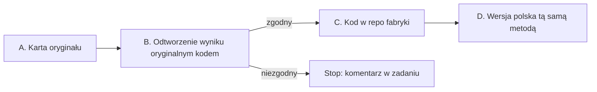

# Metodologia: najpierw oryginał, potem wersja polska

Każdy benchmark ma autorów, pracę i kod, który liczy wynik. Zanim dodasz benchmark do repo fabryki albo zbudujesz jego polską wersję, poznajesz i odtwarzasz oryginał. Polska wersja przenosi tę samą metodę na inny język. Nie wymyśla nowej.

Dlaczego tak: ten sam benchmark liczony innym promptem, inną normalizacją albo inną agregacją daje inną liczbę. Bez odtworzonego oryginału nie wiadomo, czy różnica w wyniku to model, czy kod. Jedna wspólna ścieżka (np. format cloze w `slayer_eval/hipoteza_formatu.py`) pasuje do części testów, ale nie do wszystkich: generacja, perpleksja, pary zdań i testy z agregacją po kategoriach liczą się inaczej.

Praca ma cztery etapy. Każdy kończy się plikiem w repo fabryki, w katalogu `benchmarki/<nazwa>/` (ścieżka względem `research/slayer-1b/`). Etap B jest bramką: bez odtworzonego wyniku nie przechodzisz dalej.

## A. Karta oryginału (`benchmarki/<nazwa>/ORYGINAL.md`)

Przeczytaj pracę i kod autorów. Wypełnij każde pole; czego nie da się ustalić, wpisz „nieustalone” z tym, gdzie szukałeś.

| pole | co wpisać |
|---|---|
| Co mierzy | umiejętność, jednym zdaniem, słowami autorów |
| Źródła | praca (arXiv/ACL), repo autorów z commitem, karta zbioru na HF z rewizją |
| Dane | split używany do wyników w pracy, n, licencja, czy split testowy ma ukryte odpowiedzi |
| Format zadania | wybór z k opcji, para zdań, uzupełnienie, generacja, perpleksja |
| Prompt | dokładny szablon z pracy albo kodu (separatory, spacje, etykiety odpowiedzi), liczba przykładów w prompcie i skąd są brane |
| Ocena | metryka (acc, acc_norm, exact match, F1, perpleksja, BPB) i sposób jej liczenia: po czym normalizowana jest długość (znaki, bajty, tokeny), jak normalizowany jest tekst odpowiedzi |
| Agregacja | średnia po pytaniach czy po kategoriach/paradygmatach, wagi |
| Wyniki referencyjne | co najmniej jeden opublikowany wynik modelu, który da się pobrać (model, liczba, tabela w pracy albo plik wyników) |
| Znane rozbieżności | czym różnią się popularne implementacje (np. zadanie lm-eval) od kodu autorów, znane błędy w danych, kontaminacja |

## B. Odtworzenie wyniku oryginalnym kodem (`benchmarki/<nazwa>/ODTWORZENIE.md`)

1. Uruchom kod autorów. Gdy autorzy kodu nie opublikowali, użyj implementacji, którą wskazuje praca albo leaderboard podający wyniki referencyjne (często zadanie lm-eval z konkretnego commitu) i zapisz, dlaczego ta.
2. Policz model z wynikiem referencyjnym z karty, ten sam split, ten sam prompt, ta sama rewizja modelu.
3. Zapisz komendę, commit kodu, rewizję zbioru i modelu, n, wynik z SE i różnicę wobec wartości referencyjnej.
4. Zgodny = różnica w granicach ±2 pkt dla trafności albo w granicach 2 SE, gdy SE jest większe. Dla perpleksji i BPB próg ustala zadanie #41.

Niezgodny wynik zatrzymuje pracę. Wpisz w komentarzu zadania, co policzyłeś i jaką różnicę dostałeś. Rozbieżność z oryginałem to informacja, której szuka cały zespół: w każdym wyniku liczonym dalej siedziałaby ta sama różnica.

## C. Kod w repo fabryki

Domyślnie repo fabryki woła kod z etapu B (bezpośrednio albo cienką nakładką, która tylko podaje model Slayera przez `slayer_eval/slayer_model.py` i zapisuje wyniki per pytanie). Własna implementacja, np. klucz w `slayer_eval/hipoteza_formatu.py`, jest dopuszczalna tylko po teście zgodności:

- ten sam model i te same pytania co w etapie B;
- wynik w granicach SE od wyniku oryginalnego kodu;
- zgodność decyzji per pytanie co najmniej 99% (dla perpleksji: różnica per dokument poniżej 0,1%);
- test zgodności zapisany jako `tests/test_<nazwa>_zgodnosc.py` na próbce 10–20 pytań z wynikami oryginalnego kodu w pliku, bez sieci.

Dodatkowe sposoby liczenia (cloze, BPB poprawnej odpowiedzi, PMI, inny format promptu) są dodatkiem obok wyniku oryginalną metodą, nigdy w jego miejsce. W raporcie stoją w osobnej tabeli z nazwą metody.

## D. Wersja polska (`benchmarki/<nazwa>/WERSJA_PL.md`)

### D1. Przetłumaczyć czy zbudować od zera?

Najpierw ustal, czy treść benchmarku przechodzi na polski. Metoda (format, metryka, agregacja) przechodzi zawsze. Treść nie zawsze: pytanie o stan w USA, amerykańskie prawo, sport czy obyczaje przetłumaczone na polski dalej sprawdza wiedzę o USA, a nie o Polsce.

| typ treści | przykłady | co robisz |
|---|---|---|
| Niezależna od kraju i języka | GSM8K, MathQA (matematyka), logika | tłumaczysz 1:1; zmieniasz tylko waluty, imiona i jednostki, gdy brzmią obco |
| Wiedza uniwersalna | ARC, SciQ, OpenBookQA (fizyka, biologia) | tłumaczysz i sprawdzasz próbkę |
| Wiedza lokalna i kulturowa | fakty o kraju, prawo, historia, geografia, instytucje, normy społeczne (części MMLU, TriviaQA, Social IQa) | budujesz od zera z polskiego kontekstu (Polska, region, np. Warszawa), tą samą metodą co oryginał |
| Zjawiska językowe | BLiMP, LAMBADA, WinoGrande, WSC | budujesz od zera na zjawiskach polszczyzny (np. przypadki, rodzaj, aspekt), bo angielskiej gramatyki nie da się przetłumaczyć |

Jak rozstrzygnąć: wylosuj 50 przykładów i oznacz każdy jednym z czterech typów. Zapisz to w `WERSJA_PL.md` razem z wynikiem:

- prawie wszystkie (ponad 90%) to treść niezależna albo uniwersalna → tłumaczenie;
- lokalnych albo językowych jest ponad 10% → te przykłady usuwasz i zastępujesz polskimi odpowiednikami albo budujesz cały zbiór od zera, jeśli to większość;
- zbiór budowany od zera ma te same proporcje kategorii, ten sam format i poziom trudności co oryginał, a liczba przykładów daje SE nie gorsze niż oryginał.

Na start polskich wersji bierz benchmarki, które da się przetłumaczyć (pierwsze dwa wiersze tabeli). Budowa od zera to osobne, większe zadanie i długoterminowy kierunek: testy wiedzy o Polsce i polszczyźnie, których nikt jeszcze nie ma. Wstępny podział 38 angielskich testów ze Space i istniejące polskie odpowiedniki: [BENCHMARKI_PL.md](BENCHMARKI_PL.md).

### D2. Mapowanie metody

Wersja polska zachowuje metodę z karty. Zanim zbudujesz dane, wypełnij tabelę: każdy wiersz karty oryginału i decyzja „bez zmian” albo „zmiana: co i dlaczego”.

| element | zwykle | uwagi |
|---|---|---|
| Metryka, agregacja, liczba opcji, liczba przykładów w prompcie | bez zmian | zmiana tylko z zapisanym powodem |
| Normalizacja długości | po bajtach albo znakach, jak w oryginale | po tokenach zależy od tokenizera; polskie litery z ogonkiem to 2 bajty UTF-8, co przesuwa normalizację po bajtach względem znaków |
| Prompt | tłumaczony szablon o tej samej strukturze | etykiety („Odpowiedź:”), separatory i spacje jak w oryginale |
| Dane | natywny polski zbiór o tej samej konstrukcji albo tłumaczenie | przy tłumaczeniu: kto, jakim narzędziem, próbka min. 50 przykładów sprawdzona przez człowieka, lista usuniętych przykładów (np. gra słów, która nie przechodzi na polski) |
| Kontaminacja | sprawdzona dla nowego zbioru | szczególnie gdy źródło polskich danych jest w sieci |

Dwie kontrole przed pierwszym wynikiem Slayera:

1. **Kod wersji polskiej na danych oryginalnych.** Ten sam kod uruchomiony na angielskim zbiorze i modelu z etapu B daje wynik z etapu B (te same kryteria zgodności co w C). To dowód, że przy przenoszeniu na polski nie zmieniła się metoda.
2. **Baza i model kontrolny.** Baza losowa i większościowa polskiego zbioru oraz wynik modelu, który zna polski (np. LFM2.5 z README). Wynik modelu kontrolnego na poziomie bazy znaczy, że coś jest nie tak z danymi albo promptem, zanim cokolwiek powie o Slayerze.

## Co oddajesz

PR do `feature/phase-0-foundation` z katalogiem `benchmarki/<nazwa>/` (`ORYGINAL.md`, `ODTWORZENIE.md`, dla wersji polskiej `WERSJA_PL.md`), kodem i testem zgodności, a dalej jak w README, sekcja „Definicja »zrobiony«”.

Etapy A i B można oddać osobnym, wcześniejszym PR. Recenzent sprawdza wtedy kartę i odtworzenie, zanim ktokolwiek policzy Slayera.
